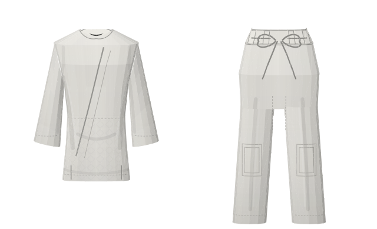
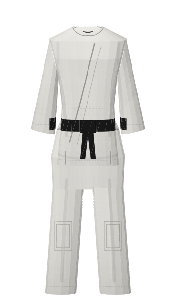
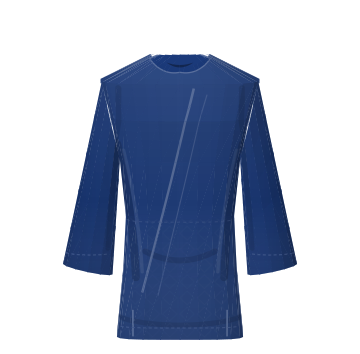

# Judogi

Jacket, trousers and belt as original SVG. Contest white or blue, rank-belt colours, named sizes, a product layout of separate pieces, or a worn suit with no body drawn. The designer keeps every choice in the address and can save SVG or PNG.

Look at the [designer](https://johnmorrisdotca.github.io/senshu-jerseys/judogi.html) (`?colour=white&mode=pieces&belt=black&size=170`).

No maker, federation or sponsor mark is drawn. Sizes and positions cite the [IJF Judogi Rules (09 03 2022)](https://78884ca60822a34fb0e6-082b8fd5551e97bc65e327988b444396.ssl.cf3.rackcdn.com/up/2022/04/IJF_Judogi_rules_-_09_03_2022_-1649423105.pdf) as facts. That document's pictures and wording are not copied.

| Picture | Mode |
| --- | --- |
|  | Pieces (jacket left, trousers right) |
|  | Suit, belt tied |
|  | Contest blue, jacket only |

```js
import { renderJudogi, judogiFrame, judogiCheck } from "@johnmorrisdotca/senshu-jerseys";

renderJudogi({ colour: "white", mode: "pieces", belt: "white", size: "170" });
judogiFrame({ colour: "blue", mode: "jacket", yaw: 40 });
judogiCheck({ size: "180" });
```

`judogiCheck` reports whether a named size meets the cited length facts (jacket to mid-thigh, sleeves leaving about 5 cm to the wrist, trousers leaving about 5 cm to the ankle, belt 4–5 cm wide with 20–30 cm hanging ends). Traditional sizes 1–7 map onto those heights.

Later tickets add back patches, embroidery and labels onto the same options object.
